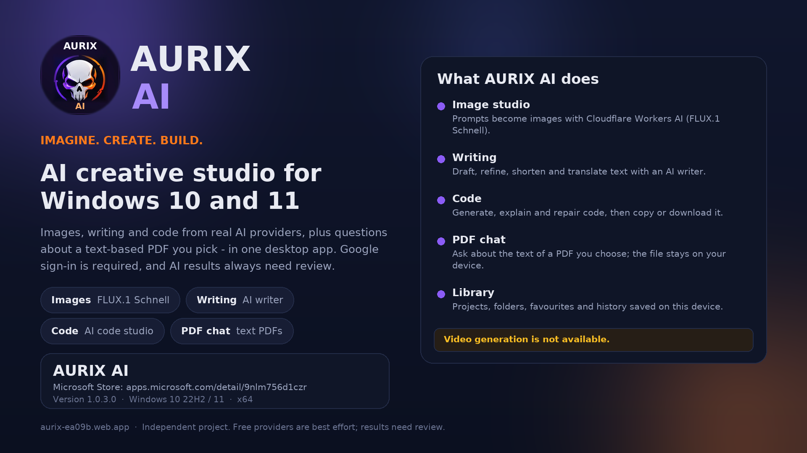

# AURIX AI — AI creative studio for images, writing, code and PDF questions

**Get AURIX AI**

| | |
|---|---|
| Microsoft Store (Windows 10 / 11, x64) | https://apps.microsoft.com/detail/9nlm756d1czr?ocid=webpdpshare — published **1.0.2.0**; ads build **1.0.3.0** pending upload |
| Web app | https://aurix-ea09b.web.app |
| English listing copy (description, features, media) | [`LISTING-EN.md`](LISTING-EN.md) |
| Walkthrough video (28 s, silent) | [`release/media/aurix-walkthrough.mp4`](release/media/aurix-walkthrough.mp4) |
| Direct unsigned MSIX (testing only) | [`WINDOWS-DOWNLOADS-AR.md`](WINDOWS-DOWNLOADS-AR.md) |
| Store error 5001 — technical report | [`STORE-ERROR-5001-AR.md`](STORE-ERROR-5001-AR.md) |
| Pre-upload MSIX audit | `python scripts/diagnose-msix.py <file>.msix` |

> **الموقع الحي:** https://aurix-ea09b.web.app (Firebase Hosting) — وتطبيق Windows منشور على Microsoft Store.
> هذا المستودع هو مصدر المشروع ونسخته الاحتياطية. لا توجد نسخة Vercel منشورة بعد اليوم.

AURIX AI is an independent Windows and web app that puts four AI tools in one workspace:
image generation (Cloudflare Workers AI · FLUX.1 Schnell), writing and translation, a code
studio, and questions about a text-based PDF you own. Work is organised in local projects,
folders, favourites and history. Google sign-in is required; every AI action is authorised
per user by the app's own backend.

**Honest limits:** video generation is not available; generation needs an internet connection;
images are square only; free-tier providers can be slow, rate-limited or unavailable; AI output
always needs review; English is the primary interface language with partial French/Arabic
controls. The Windows build shows MG Ads banners on signed-in screens only. Full detail, with
the complete feature list and the media kit, is in [`LISTING-EN.md`](LISTING-EN.md).

**Preview:** `release/preview/index.html` · **Installable Blogger theme:** `release/aurix-blogger.xml`

## Windows 10 / 11 desktop (x64)

Electron desktop packaging now includes the current dashboard, images, code, writing, chat/PDF, projects and settings from the same `src/` files. Run `npm ci`, then `npm run desktop` to develop or `npm run dist:win -- --publish never` on Windows to build an NSIS installer and a portable EXE. A Windows GitHub Actions workflow is in `.github/workflows/windows.yml`.

**Build status:** the source is now **1.0.3.0** and both manifest display names are **AURIX AI**.
The published Store package is 1.0.2.0; 1.0.3.0 adds the MG Ads banners. A version bump is mandatory,
not cosmetic: Partner Center rejected a second `Ahmedbecetti.AURIXAI_1.0.2.0_x64` package with
different contents, because a package full name is `<IdentityName>_<Version>_<Arch>` and must be
unique. `scripts/store.cjs` now refuses any version that is already published or not higher than the
live one, and the release tags derive from `package.json`. The identity, publisher and PFN are unchanged. The archive passes
ZIP/CRC/block-map/staging checks, `MakeAppx pack`/unpack and `scripts/verify-msix.py`, and the
package is published as a GitHub release ([direct MSIX download and checksums](WINDOWS-DOWNLOADS-AR.md)).
The MSIX on that page is unsigned and is for testing; Microsoft Store is the supported install
path. Google sign-in inside the desktop app uses the included auth bridge (`src/desktop-auth.html`,
`src/desktop-auth.mjs`), which must be deployed with the site; packaging does not enable any
feature the app does not have.

### Microsoft Store (MSIX candidate)

The Store channel is separate from NSIS/Portable. The owner-supplied public identity is tracked in `store/identity.store.json` (`Ahmedbecetti.AURIXAI`, publisher `Ahmedbecetti`); PFN/SID and Store ID `9NLM756D1CZR` are in `store/product.json` and cross-checked. The reserved display name is **AURIX AI**, based on the owner-supplied Partner Center page and its explicit rejection of AURIX. The product guard rejects a profile override that would restore the unreserved name. An optional ignored `store/identity.json` can override the tracked profile. On Windows with the SDK installed, run `npm ci`, `npm run store:validate`, then `npm run dist:store`. The build stages the x64 runtime and uses MakeAppx with validation enabled; `.github/workflows/microsoft-store.yml` provides a manual Windows build with the same public inputs.

Package logos, listing drafts (English/Arabic/French), review notes and reporting procedures are in `store/`. A user-reviewed AI content report/email/copy control and a public Windows privacy page (`/pages/windows-privacy.html`) are part of the web build.

**Store status:** the owner reports that AURIX AI 1.0.2.0 is live on the Microsoft Store at
https://apps.microsoft.com/detail/9nlm756d1czr (`store/product.json` → `publicationStatus`
`LIVE_OWNER_REPORTED`). The repository cannot verify the listing page itself. The dev-side MSIX
build, MakeAppx pack/unpack and integrity checks pass; real Windows screenshots and the Windows
App Certification Kit run remain owner-side tasks, so the media in `release/media/` is brand
artwork, never a simulated screenshot. Interactive Windows 10/11 end-to-end testing of every
advertised feature is still recommended after each release. See
[Microsoft Store preparation and release gates (Arabic)](STORE-AR.md).

The same studio is shipped as a static app for the owner's `skullaistudio.blogspot.com` site, built from the project owner's reference artwork (cropped icon in `src/brand-icon.webp`). Frontend source: `src/app.html`, `src/styles.css`, `src/app.js`; rebuild with `python build.py`. The web app is **live on Firebase Hosting** at https://aurix-ea09b.web.app with `robots.txt` + `sitemap.xml` published, so public pages are crawlable while the interactive studio still requires Google sign-in. The Blogger theme in `release/aurix-blogger.xml` has **not** been installed on the owner's Blogger account; Blogger admin access is required. See `DEPLOYED-AR.md`.

## Feature matrix (current source)

| Feature | Implementation | Real availability |
|---|---|---|
| Images | `src/app.js` → authenticated `/api/image` → Cloudflare Workers AI, FLUX.1 Schnell. Optional style direction, fast (4 steps) / detail (8 steps), prompt translation to English, cancel, download, local image storage in IndexedDB | Square output only; the free Workers Free daily allocation can run out; details and exact counts are not guaranteed; every image needs review |
| Writing | `/api/text` → Pollinations. Eight actions: article, social caption, product description, rewrite, summarise, grammar, translate (EN/FR/AR), creative prompt. Copy, download, save | Live text responses verified; free tier is rate-limited and best effort |
| Code | Same `/api/text` endpoint: generate, explain, repair; copy and file download | Live text responses verified |
| PDF chat | text-based PDF (≤5 MB, ≤20 pages) extracted locally with pdf.js; only the excerpt is sent to `/api/chat` → Google Gemini | Text PDFs only — scanned PDFs need OCR, which is not included; chat needs the configured backend |
| Library | Projects, folders, favourites, history per signed-in account, on-device; JSON export and deletion in Settings | Local data is lost if app/browser storage is cleared; JSON export does not include image bytes |
| Accounts | Firebase Authentication with Google sign-in; optional cloud copies for supported text/code projects in Firestore, per-user rules | Google sign-in gates every AI action; email sign-in is not built |
| Windows ads | MG Ads banners from `desktop/ads.cjs` (bundled credentials) on signed-in Windows screens only | Included in the 1.0.3.0 build (the published 1.0.2.0 predates the banners); the website and the sign-in screen show no ads |
| Internationalization | English default, French/Arabic controls, Arabic RTL shell | Main tool copy is English; full French/Arabic localization is unfinished |
| Video | Explicitly disabled and labelled unavailable in the UI | No provider configured — this is stated in the app and in every listing |
| Legal pages | About, Contact, Privacy, Terms in `release/*-page.html` + `pages/windows-privacy.html` | Published on Firebase Hosting with `robots.txt` + `sitemap.xml` |

## Optional original tutorial pages

Three original, substantial tutorial bodies are included in `release/image-guide-page.html`, `release/code-guide-page.html`, and `release/writer-guide-page.html`. Create them as Blogger pages or posts in HTML view after reviewing/editing them for the owner’s voice. They are **not** automatically published, linked, indexed or proof of AdSense eligibility. Add accurate page titles and individual search descriptions in Blogger.

## Free-tier and usage constraints

Every AI call goes through the app's own backend, which authorises the user's Firebase ID token
and applies a per-user rate limit. Image prompts are handled by Cloudflare Workers AI
(FLUX.1 Schnell); text and code prompts by Pollinations; chat by Google Gemini. All three run on
free tiers, so any of them can be slow, rate-limited, refuse a prompt, or be unavailable for a
while. The app shows no invented credit balances, no demo activity and no fake usage numbers.

**Commercial-use caveat:** free providers do not grant blanket commercial rights for every model
and every output. Do not assume monetization or commercial reuse is authorised without checking
the current conditions with each provider, and do not treat free capacity as a service-level
guarantee. Provider keys belong in the backend, never in the app bundle or the Blogger theme.

See [`DEPLOYED-AR.md`](DEPLOYED-AR.md) for live status and remaining owner actions; [`NEXT-STEPS-AR.md`](NEXT-STEPS-AR.md) is an earlier setup plan and may describe steps already completed.

## Install on Blogger (site owner only)

1. Go to [Blogger](https://www.blogger.com) and select `skullaistudio.blogspot.com`. Back up the existing theme: **Theme → ▼ → Backup**.
2. **Theme → ▼ → Restore → Upload** `release/aurix-blogger.xml` (UI wording varies by locale). **Do not paste API keys** into the theme.
3. Under **Pages**, create pages named **About**, **Contact**, **Privacy Policy**, **Terms of Service**. Open HTML mode and paste each matching `release/*-page.html` body. Set URLs to `about`, `contact`, `privacy`, `terms` as shown in the theme links; Blogger may assign different URLs, so confirm the four links after publishing and update theme links if needed.
4. Verify that the Contact page’s email address works before the public launch. Review/adjust policy for actual practices and local law. **Do not claim it is published until it is**.
5. Test all studio features on your Blogger domain and on a phone. Send a screenshot of Blogger theme upload results if validation fails; Blogger's editor can enforce extra constraints not testable offline.
6. Add the blog to Google Search Console (URL-prefix property). Submit Blogger's own `/sitemap.xml`; Blogger's `robots.txt` is managed by Blogger. There is no separate XML sitemap file to upload. Verify indexing; it is not automatic or guaranteed.
7. Only after meaningful original content, policy/contact verification, and network approval, enable compliant ads through Blogger Earnings or your approved network. No ads appear in this theme by default. Do not assume `blogspot.com` or any platform guarantees AdSense approval.

### What cannot be finished on Blogger alone

A Blogger theme has no safe server-side secret store and no robust server-side rate limiting, which is why the live app talks to the AURIX backend instead of calling providers from the page. Per-user Firestore rules are not a server-side generation or abuse quota; add App Check and monitor quotas before opening registration widely. Provider keys and paid/limited API quotas need the secure backend that already exists in `backend/`. Video has no sustainable verified free provider, so it remains unavailable.

## History and older notes

- [`QUALITY-FIX-AR.md`](QUALITY-FIX-AR.md) — the 2026-10-24 Arabic-prompt failure, the rate-limit
  card, bounded waits/cancel and the tests that locked the fix in.
- [`AURIX-AUDIT-2026-10-24-AR.md`](AURIX-AUDIT-2026-10-24-AR.md) — point-in-time audit.
- [`ADS-INTEGRATION-AR.md`](ADS-INTEGRATION-AR.md) — how the MG Ads banners in the Windows build work.
- [`INSTALL-AR.md`](INSTALL-AR.md), [`NEXT-STEPS-AR.md`](NEXT-STEPS-AR.md) — setup notes from earlier phases.

Temporary deployment bundles (`adsense-verify-update/`, `image-update/`, `one-upload/`,
`indexing-update/`, `text-sitemap-update/`, `ui-polish-update/`, `updates/`) were removed: those
steps are already in `src/`, `release/preview/` and `backend/`, so the copies only added clutter
and stopped matching the shipped app. The `store/submission/media/` generator scripts were removed
for the same reason — the media kit that is actually published now lives in `release/media/` and is
built by `scripts/make-listing-media.py`.

## Quality checks

`npm ci && npm test` rebuilds the web output and runs the UI checks with repository-local
`happy-dom` / `fake-indexeddb`, the backend checks, and the desktop authentication and policy
tests — 36 checks in total, 13 of which are the ads verifier (`npm run ads:verify`). Node.js 22+
and Python 3.10+ are required. The MSIX packaging also has its own integrity verifier
(`scripts/verify-msix.py`) and Store guard (`node scripts/store.cjs --check`).

Media: `python scripts/make-listing-media.py` rebuilds the hero images and the walkthrough video
with Pillow + `imageio-ffmpeg`; the outputs are committed in `release/media/` so nobody needs the
toolchain to use them.
